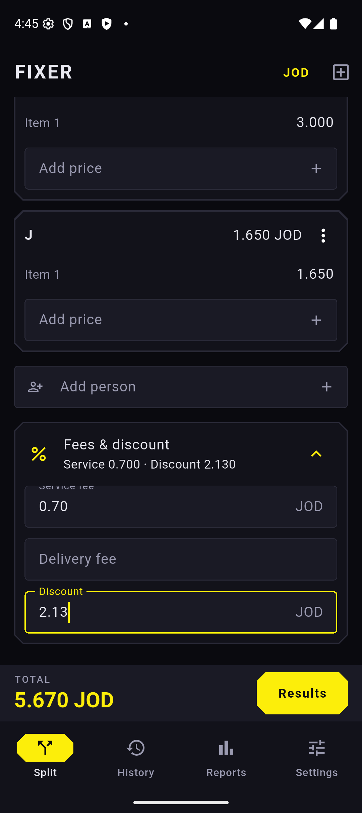
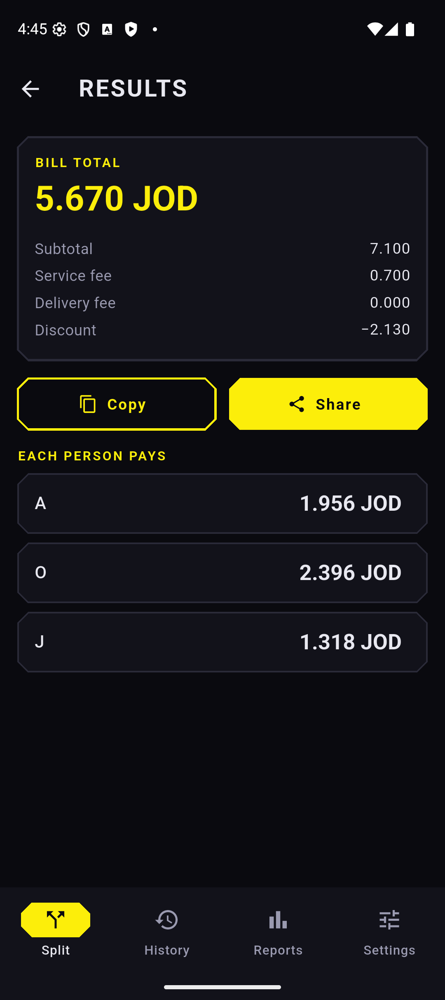
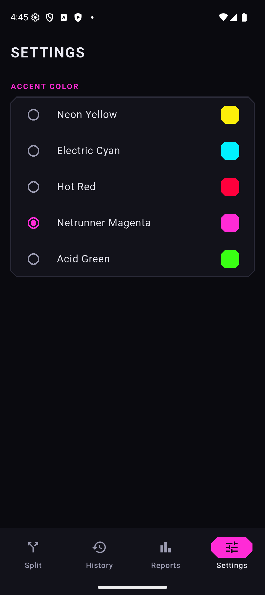

# Fixer

Split a shared bill fairly. Each person enters their items; service fee, delivery fee and discount are shared in proportion to what each person ordered, and the per-person amounts always add up exactly to the bill total.

Flutter app, Android first (iOS-ready structure). Dark, cyberpunk-inspired theme with selectable accent colors. Works offline.

<p>
  
  
  
</p>

## Status
- ✅ Calculation engine: integer minor units, largest-remainder rounding, fully tested ([rounding rule](docs/ROUNDING.md))
- ✅ Bill entry, live totals, results, copy & share, accent colors
- ✅ History (auto-saved, offline SQLite, sync-ready), search, multiple tags per bill
- ✅ Add people from contacts; send each person their share via WhatsApp or SMS
- ⏳ Monthly reports, saved message templates, settings

## Run
```sh
flutter pub get
flutter test
flutter run
```

## Structure
```
lib/
  core/       money (Money, Currency, allocation), theme, shared widgets
  features/   bill, results, messaging, settings: each split into domain / application / data / presentation
test/         unit tests for money + domain, widget tests for the main flow
docs/         brief, plan, rounding rule, screenshots
```
